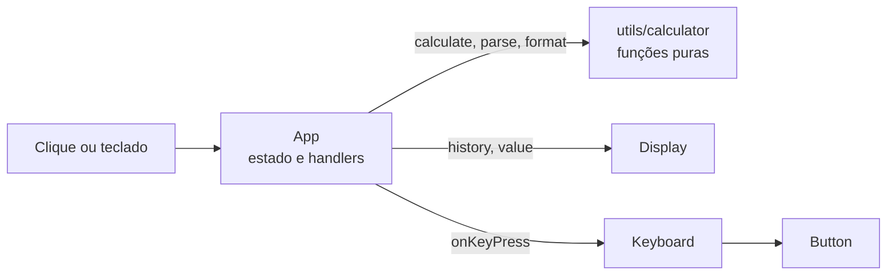

<h1 align="center">🧮 Calculadora</h1>

<p align="center">
  Calculadora inspirada na do Windows, feita com <strong>React</strong> e <strong>TypeScript</strong>.
</p>

<p align="center">
  <a href="https://calculadora-react-alpha.vercel.app/"><strong>🔗 Ver demo online</strong></a>
</p>

<p align="center">
  
</p>

---

## ✨ Funcionalidades

- Soma, subtração, multiplicação e divisão, com números decimais
- Encadeamento de operações (`2 + 3 × 4 …`)
- Repetição da última operação ao pressionar `=` várias vezes
- Alternar sinal (`±`), `CE`, `C` e backspace
- Tratamento de divisão por zero, com recuperação do estado
- **Suporte completo ao teclado físico**

| Tecla | Ação | Tecla | Ação |
| ----- | ---- | ----- | ---- |
| `0-9` `,` `.` | Dígitos | `Enter` `=` | Resultado |
| `+` `-` `*` `/` | Operadores | `Backspace` | Apagar dígito |
| `Esc` | Limpar tudo (C) | `Delete` | Limpar entrada (CE) |

---

## 🛠️ Stack

| Tecnologia | Uso |
| ---------- | --- |
| [React 19](https://react.dev/) | Interface e estado (`useState`, `useEffect`) |
| [TypeScript](https://www.typescriptlang.org/) | Tipagem estática |
| [Vite](https://vite.dev/) | Dev server e build |
| CSS | Um arquivo por componente, mais estilos globais |
| ESLint | Lint, com plugins de React Hooks e React Refresh |
| [Vercel](https://vercel.com/) | Deploy |

---

## 🏗️ Arquitetura

O estado vive em um único lugar (`App`). Os componentes só exibem dados e avisam quando algo acontece. As contas ficam em funções puras, fora do React.



```
src/
├── App.tsx                 # Estado e regras de interação (handlers, teclado físico)
├── components/
│   ├── Display/            # Exibe histórico e valor atual
│   ├── Keyboard/           # Define as 20 teclas e renderiza os botões
│   ├── Button/             # Botão genérico, estilizado por tipo de tecla
│   └── Credits/            # Rodapé
├── utils/calculator.ts     # calculate(), parseDisplayValue(), formatNumberToDisplay()
└── types/                  # Key, KeyType e Operator
```

**Decisões de projeto**

- **Estado centralizado em `App`.** A calculadora é uma pequena máquina de estados. Com tudo no mesmo lugar, cada tecla se resolve em um único fluxo.
- **Componentes de apresentação.** `Display`, `Keyboard` e `Button` não têm lógica de negócio e recebem tudo por props.
- **Mesmo caminho para mouse e teclado.** Os dois geram um objeto `Key` e chamam `handleKeyPress`, então o comportamento é idêntico.
- **Tipos que impedem estados inválidos.** `KeyType` e `Operator` são uniões literais, e o `switch` de `calculate` cobre todos os operadores.
- **Cálculo isolado.** `utils/calculator.ts` não depende do React, então é fácil de testar e de reaproveitar.

---

## 🚀 Deploy

Publicado na **Vercel**, com deploy automático a cada push na branch `main`.

🔗 **https://calculadora-react-alpha.vercel.app/**

---

## ▶️ Como rodar localmente

Requer [Node.js](https://nodejs.org/).

```bash
git clone https://github.com/rafaelvassis/calculadora-React.git
cd calculadora-React
npm install
npm run dev
```

| Comando | Descrição |
| ------- | --------- |
| `npm run dev` | Servidor de desenvolvimento |
| `npm run build` | Checagem de tipos e build de produção |
| `npm run preview` | Serve o build localmente |
| `npm run lint` | Executa o ESLint |

---

## 🗺️ Próximos passos

- [ ] Testes automatizados para `utils/calculator.ts`
- [ ] Histórico de operações
- [ ] Memória (MC, MR, M+, M-)
- [ ] Tema claro e escuro

---

<p align="center">
  <br>
  <strong>Desenvolvido por Rafael Vassis</strong>
</p>
